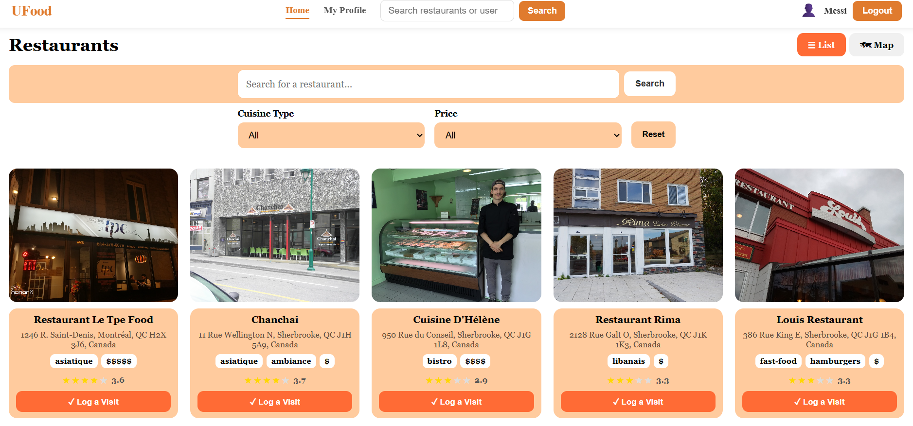
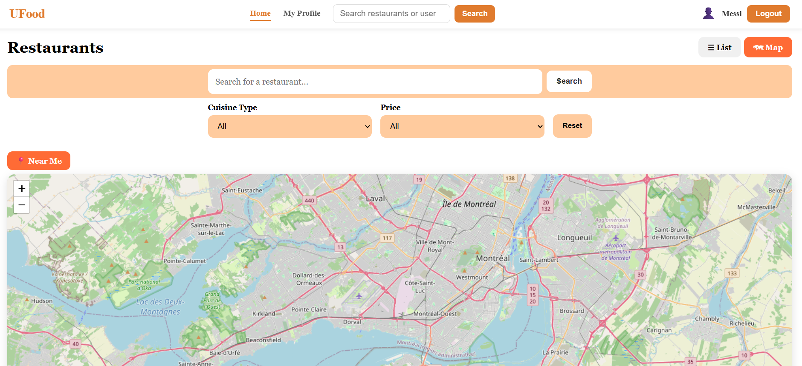
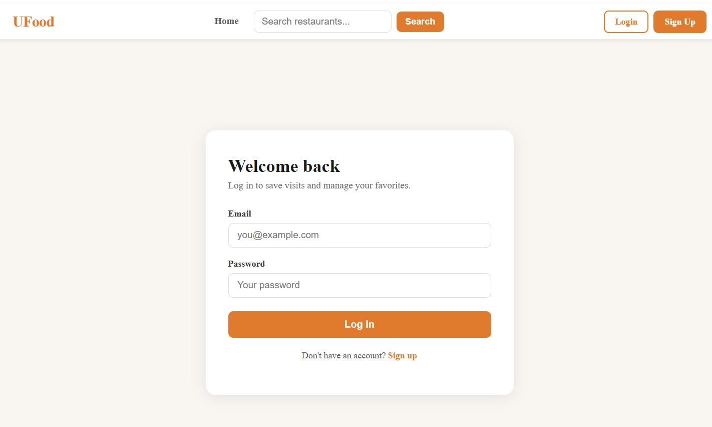
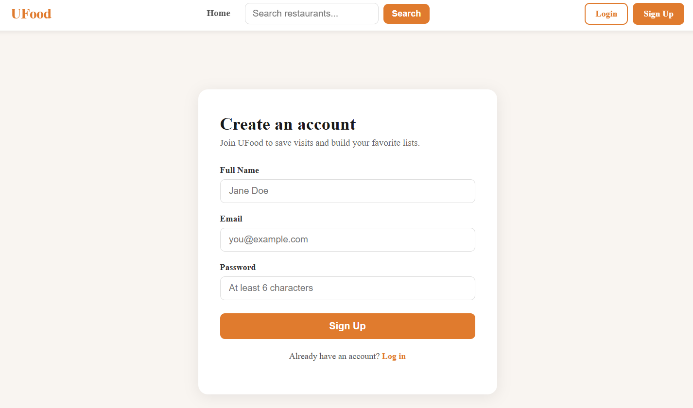
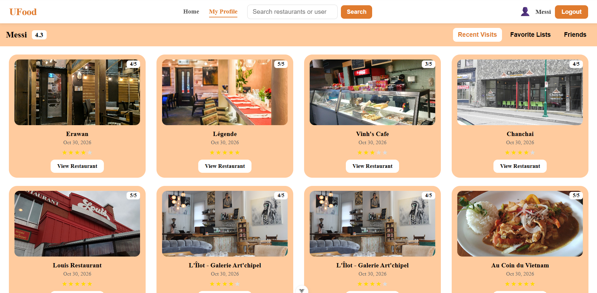
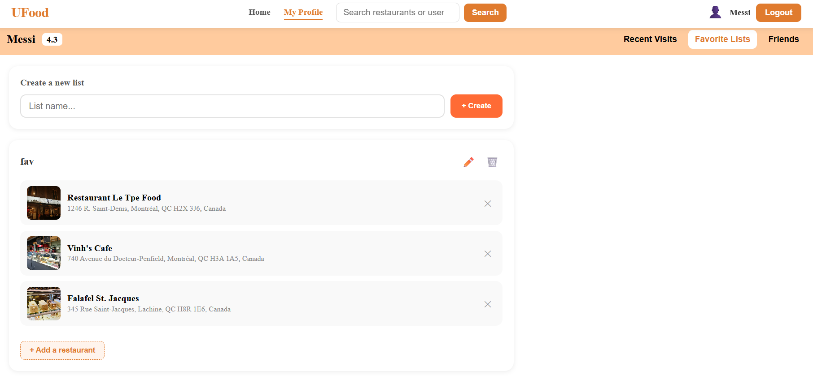
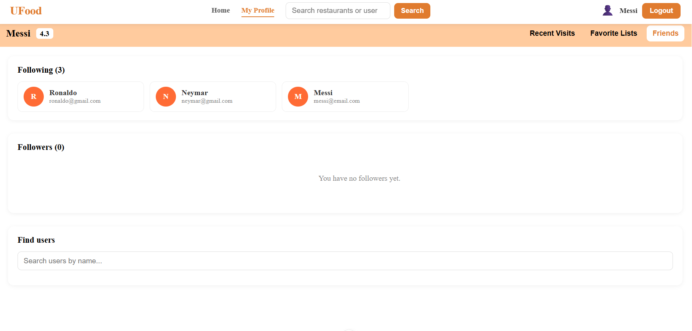
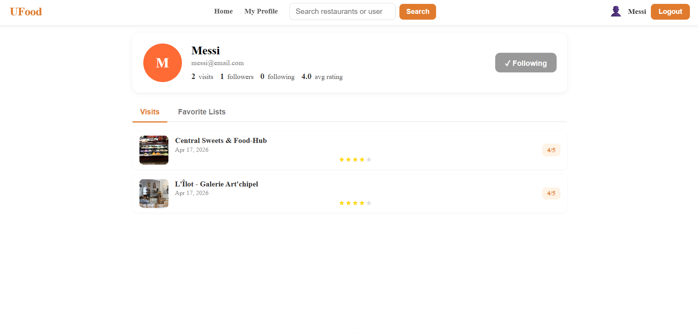

# UFood 🍽️

Application web de découverte de restaurants. On peut chercher et filtrer des restaurants, consulter leur fiche et leur itinéraire, noter ses visites, créer des listes de favoris et suivre d'autres utilisateurs.

Frontend connecté à l'API sécurisée UFood.

## Technologies

| Domaine | Outils |
|---|---|
| Frontend | Vue.js 3 (Composition API, `<script setup>`), Vue Router, Vite |
| Cartographie | Leaflet, Leaflet Routing Machine, OpenStreetMap, API Geolocation |
| Authentification | Jeton JWT (Bearer) stocké en cookie (js-cookie), gardes de navigation |
| Tests | Vitest, Vue Test Utils, jsdom |
| Qualité | ESLint, Prettier, Husky + lint-staged (hooks pre-commit) |

## Fonctionnalités

- **Authentification** : inscription, connexion, routes protégées et redirection automatique si la session expire.
- **Accueil** : liste des restaurants, recherche, filtres par cuisine et par prix.
- **Recherche avec autocomplétion** sur les restaurants et les utilisateurs.
- **Fiche restaurant** : photos, adresse, cuisine, prix, note moyenne, carte avec **itinéraire** depuis la position de l'utilisateur et **restaurants similaires**.
- **Visites** : noter un restaurant visité (fenêtre modale), historique des visites.
- **Listes de favoris** : créer, renommer, supprimer, ajouter et retirer des restaurants.
- **Social** : profils publics, abonnés / abonnements, suivre un utilisateur.

## Aperçu

### Accueil

### Carte et itinéraire

### Connexion / Inscription
| Connexion | Inscription |
|---|---|
|  |  |

### Profil
| Recent visits | Favorites | 
|---|---|
|  |  |
| friends | other user |
|---|---|
|  |  |
## Mes tâches

- Implémentation des fonctionnalités concernant les restaurants favoris/visités
- Implémentation de l'interface pour le profil utilisateur
- Barre de recherche avec autocomplétion réutilisable (restaurants et utilisateurs).
- Recommandation de restaurants similaires selon la cuisine et la gamme de prix.
- Gestion des listes de favoris et des abonnements entre utilisateurs.

## Ce que j'ai appris

- Construire une **SPA** avec Vue 3 : composants réutilisables, props, événements et Composition API.
- Gérer l'**authentification par jeton** côté client et protéger des routes avec Vue Router.
- Centraliser les appels HTTP pour éviter la duplication et gérer les erreurs de façon uniforme.
- Intégrer une **carte interactive** et un service d'itinéraire dans un composant Vue.

## Code source

Le code source est hébergé dans un dépôt privé (projet universitaire, Université Laval).
